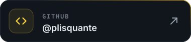
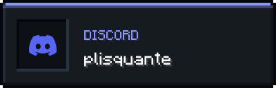

  

Hi, I'm **Plisquante**. I write Minecraft plugins and mods, mostly in **Kotlin** and **Java**: server-side work on Paper and Spigot, and Fabric mods when I have some free time.

Right now most of my time goes into two plugins of my own, **OmniGuard** and **Themis**. I care about code that is clean, readable and easy to maintain, and I'm always happy to collaborate or review someone else's code.

##  Projects

  
  

**OmniGuard** stops crash exploits before they are decoded, catches duplicated items however they were made and keeps lag machines and bot floods in check, without punishing players who share an IP. [Website](https://plisquante.github.io/omniguard/) · [Docs](https://plisquante.github.io/omniguard/docs/)

**Themis** keeps moderation consistent across a whole network: every punishment is recorded, repeat offences escalate on their own, and staff, plugins and Discord bots all work from the same record. [Website](https://plisquante.github.io/themis/) · [Wiki](https://plisquante.github.io/themis/wiki/)

##  Toolbox

##  Activity

##  Contact

Open to working together on Minecraft projects, code reviews, or just talking plugins. Mail me at [plisquante@gmail.com](mailto:plisquante@gmail.com) or add me on Discord as `plisquante`.

  
  
  

 

   
  Pixel font: "Minecraft" by Pwnage_Block, CC BY-SA 3.0

