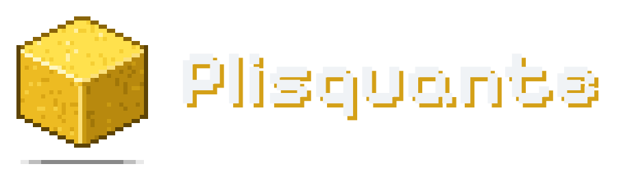
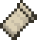

  <picture>
    <source media="(prefers-color-scheme: dark)" srcset="./assets/header-dark.svg"/>
    <source media="(prefers-color-scheme: light)" srcset="./assets/header-light.svg"/>
    
  </picture>

  Minecraft plugin &amp; mod developer &nbsp;·&nbsp; Kotlin &amp; Java

 

Hi, I'm **Plisquante**. I write Minecraft plugins and mods, mostly in **Kotlin** and **Java**: server-side work on Paper and Spigot, and Fabric mods when I have some free time.

Most of my time right now goes into two plugins of my own, **[OmniGuard](https://plisquante.github.io/omniguard/)** and **[Themis](https://plisquante.github.io/themis/)**. I care about code that is clean, readable and easy to maintain, and I'm always happy to collaborate on something or review someone else's code.

## Projects

<table>
  <tr>
    <td width="120" align="center" valign="top">
       
      
    </td>
    <td valign="top">
      <h3><a href="https://plisquante.github.io/omniguard/">OmniGuard</a></h3>
      
<b>All-in-one security for Minecraft servers.</b> It stops crash exploits before they are decoded, catches duplicated items however they were made, freezes lag machines and rides out bot floods, without punishing the ten friends who share one IP.

      <ul>
        <li>Packet firewall that runs on the network thread, with byte and frame floods dropped before decoding</li>
        <li>Item Provenance Ledger: valuable items get an invisible identity, so a dupe is caught whatever exploit made it</li>
        <li>Lag-machine shield, bot-flood protection with an automatic attack mode, and a one-command lockdown</li>
      </ul>
      
Paper · Purpur · Spigot · Folia &nbsp;|&nbsp; 1.17.1 → 26.x &nbsp;|&nbsp; 37/37 real exploits blocked in the release test suite

      
<a href="https://plisquante.github.io/omniguard/">Website</a> &nbsp;·&nbsp; <a href="https://plisquante.github.io/omniguard/docs/">Docs</a>

    </td>
  </tr>
  <tr>
    <td width="120" align="center" valign="top">
       
      
    </td>
    <td valign="top">
      <h3><a href="https://plisquante.github.io/themis/">Themis</a></h3>
      
<b>A moderation plugin that keeps staff fair and consistent.</b> One jar for single servers and whole networks: every punishment is recorded, every decision follows the same rules, and punishments escalate on their own.

      <ul>
        <li>Escalating bans, mutes and warnings from punishment templates</li>
        <li>One record across the whole network, alt-account detection and AutoMod</li>
        <li>Nine languages, an MIT-licensed Java API, a REST API with signed webhooks, and imports from LiteBans and AdvancedBan</li>
      </ul>
      
Paper 1.21 → 26.x · Folia · Velocity 3.4+ · BungeeCord &nbsp;|&nbsp; Java 21

      
<a href="https://plisquante.github.io/themis/">Website</a> &nbsp;·&nbsp; <a href="https://plisquante.github.io/themis/wiki/">Wiki</a>

    </td>
  </tr>
</table>

## What I work with

<table>
  <tr>
    <td><b>Languages</b></td>
    <td>
      &nbsp;Kotlin &nbsp;&nbsp;
      &nbsp;Java
    </td>
  </tr>
  <tr>
    <td><b>Minecraft</b></td>
    <td>
      &nbsp;Paper &nbsp;&nbsp;
      &nbsp;Spigot / Bukkit &nbsp;&nbsp;
      &nbsp;Velocity &nbsp;&nbsp;
      &nbsp;Fabric
    </td>
  </tr>
  <tr>
    <td><b>Tools</b></td>
    <td>
      &nbsp;IntelliJ IDEA &nbsp;&nbsp;
      &nbsp;VS Code &nbsp;&nbsp;
      &nbsp;Git &nbsp;&nbsp;
      &nbsp;Gradle
    </td>
  </tr>
  <tr>
    <td><b>Hosting</b></td>
    <td>
      &nbsp;Pterodactyl &nbsp;&nbsp;
      &nbsp;Cloudflare
    </td>
  </tr>
</table>

## GitHub activity

  <picture>
    <source media="(prefers-color-scheme: dark)" srcset="https://streak-stats.demolab.com/?user=plisquante&hide_border=true&background=00000000&ring=FFD93D&fire=FFD93D&currStreakLabel=FFD93D&currStreakNum=E6EDF3&sideNums=E6EDF3&sideLabels=9198A1&dates=9198A1&stroke=30363D"/>
    <source media="(prefers-color-scheme: light)" srcset="https://streak-stats.demolab.com/?user=plisquante&hide_border=true&background=00000000&ring=D4A017&fire=D4A017&currStreakLabel=B8860B&currStreakNum=1F2328&sideNums=1F2328&sideLabels=59636E&dates=59636E&stroke=D1D9E0"/>
    
  </picture>

<picture>
  <source media="(prefers-color-scheme: dark)" srcset="https://raw.githubusercontent.com/plisquante/plisquante/output/github-contribution-grid-snake-dark.svg"/>
  <source media="(prefers-color-scheme: light)" srcset="https://raw.githubusercontent.com/plisquante/plisquante/output/github-contribution-grid-snake.svg"/>
  
</picture>

## Get in touch

I'm open to working together on Minecraft projects, code reviews, or just talking plugins. The easiest ways to reach me:

&nbsp; **Email:** [plisquante@gmail.com](mailto:plisquante@gmail.com) 
&nbsp; **Discord:** `plisquante` 
&nbsp; **GitHub:** [@plisquante](https://github.com/plisquante)

 

  

