  

  
  
  
  

 

<picture>
  <source media="(prefers-color-scheme: light)" srcset="./assets/label-about-light.svg"/>
  
</picture>

  

<picture>
  <source media="(prefers-color-scheme: light)" srcset="./assets/label-projects-light.svg"/>
  
</picture>

  &nbsp;

  

 

<picture>
  <source media="(prefers-color-scheme: light)" srcset="./assets/label-toolbox-light.svg"/>
  
</picture>

  

<picture>
  <source media="(prefers-color-scheme: light)" srcset="./assets/label-activity-light.svg"/>
  
</picture>

  &nbsp;

  

  <picture>
    <source media="(prefers-color-scheme: dark)" srcset="https://raw.githubusercontent.com/plisquante/plisquante/output/github-contribution-grid-snake-dark.svg"/>
    <source media="(prefers-color-scheme: light)" srcset="https://raw.githubusercontent.com/plisquante/plisquante/output/github-contribution-grid-snake.svg"/>
    
  </picture>

 

<picture>
  <source media="(prefers-color-scheme: light)" srcset="./assets/label-contact-light.svg"/>
  
</picture>

  &nbsp;&nbsp;

 

